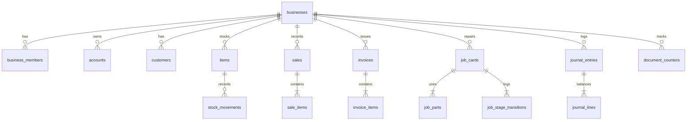
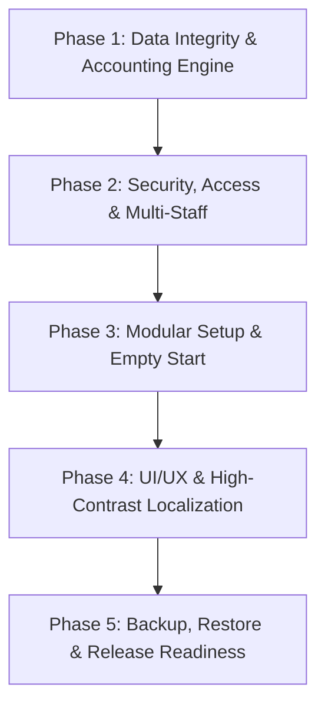

# Production-Ready Engineering Plan: BusinessOS

**Date**: November 2026  
**Status**: PROPOSED (Awaiting User Approval Before Code Modification)  
**Author**: Antigravity Assistant  
**Target Systems**: Android 8.0+ (API 26 to 35), Offline-First SQLite/Room, Jetpack Compose

---

## 1. Principles & Design Rules

1. **Basic Over Clever**: Workflows designed for Kenyan stall and garage operators (aged 40+), completing common sales or intake actions in 3 taps.
2. **Correctness First**:
   - Every financial value stored and calculated in `Long` minor units (cents / Kenyan cents: 1 KSh = 100 cents). Zero floating-point `Double` in money calculations.
   - Double-entry invariants: total debits == total credits for every posting.
   - Atomic database transactions (`withTransaction`): no operation ever half-completes.
   - Strict audit trails: no physical deletion of financial records; voiding with balancing reversals only.
3. **Strict Scope Discipline**:
   - **Out of Scope (Delete or Remove)**: Cloud sync, fake SyncManager/SyncRepository, eTIMS/KRA stubs, fake subscription billing/limits, UpdateManager.
   - **AI Assistant**: Disabled behind a default-off flag (`FeatureFlag.ENABLE_AI_ASSISTANT = false`) and removed from navigation.
   - **3D Graphics & Gimmicks**: Decorative 3D cards deleted; 3D vehicle inspector disabled behind a default-off flag (`FeatureFlag.ENABLE_3D_INSPECTOR = false`).

---

## 2. Proposed Normalized Database Schema (Baseline Version 1)

Since there are no production users yet, Room will be reset to a clean production baseline schema **Version 1** with schema export enabled (`schemas/`). All destructive migration fallbacks will be permanently removed.

### 2.1 Core Entities & Tables



#### 1. `businesses`
- `id` (TEXT, PK): UUID.
- `name` (TEXT, NOT NULL): Business legal/trade name.
- `phone` (TEXT, NOT NULL): Contact phone.
- `address` (TEXT, DEFAULT ''): Physical market/street address.
- `receiptFooter` (TEXT, DEFAULT ''): Message printed/shared on receipts.
- `isShopEnabled` (INTEGER, NOT NULL): 1 if SHOP module active, 0 otherwise.
- `isGarageEnabled` (INTEGER, NOT NULL): 1 if GARAGE module active, 0 otherwise.
- `isDemo` (INTEGER, NOT NULL, DEFAULT 0): 1 if isolated Sandbox Demo workspace, 0 for real Live business.
- `allowNegativeStock` (INTEGER, NOT NULL, DEFAULT 0): Block negative inventory unless explicitly permitted.
- `createdAt` (INTEGER, NOT NULL): UTC epoch milliseconds.
- `updatedAt` (INTEGER, NOT NULL): UTC epoch milliseconds.

#### 2. `users` & `business_members`
- `users`:
  - `id` (TEXT, PK): UUID.
  - `name` (TEXT, NOT NULL)
  - `phone` (TEXT, NOT NULL, UNIQUE): Normalized phone (`+254...`).
  - `pinSalt` (TEXT, NOT NULL): Cryptographic salt (Base64).
  - `pinHash` (TEXT, NOT NULL): PBKDF2WithHmacSHA256 salted hash of 6-digit PIN.
  - `failedAttempts` (INTEGER, NOT NULL, DEFAULT 0): Rate limit counter.
  - `lockoutUntil` (INTEGER, NOT NULL, DEFAULT 0): UTC epoch millis lockout timestamp.
  - `createdAt` (INTEGER, NOT NULL)
- `business_members`:
  - `businessId` (TEXT, NOT NULL, FK -> businesses.id ON DELETE CASCADE)
  - `userId` (TEXT, NOT NULL, FK -> users.id ON DELETE CASCADE)
  - `role` (TEXT, NOT NULL): `OWNER`, `MANAGER`, `CASHIER`, `VIEWER`.
  - Composite PK: `(businessId, userId)`.

#### 3. `document_counters` (Atomic Per-Business Sequential Numbering)
- `businessId` (TEXT, NOT NULL, FK -> businesses.id ON DELETE CASCADE)
- `documentType` (TEXT, NOT NULL): `SALE`, `INVOICE`, `PAYMENT`, `JOURNAL`, `BILL`.
- `currentValue` (INTEGER, NOT NULL, DEFAULT 0): Monotonically increasing counter.
- Composite PK: `(businessId, documentType)`.
- *Rule*: Incremented within the same `withTransaction` block. Formats: `REC-0001`, `INV-0001`, `JE-0001`, `PAY-0001`.

#### 4. `items` & `stock_movements` (Normalized Inventory)
- `items`:
  - `id` (TEXT, PK): UUID.
  - `businessId` (TEXT, NOT NULL, Index, FK -> businesses.id ON DELETE CASCADE)
  - `name` (TEXT, NOT NULL)
  - `sku` (TEXT, DEFAULT NULL): Optional barcode or catalog code.
  - `category` (TEXT, NOT NULL, DEFAULT 'General'): User-defined category.
  - `unit` (TEXT, NOT NULL, DEFAULT 'pcs'): e.g., pcs, kg, pairs, litres.
  - `costPriceCents` (INTEGER, NOT NULL, DEFAULT 0): `Long` minor units.
  - `retailPriceCents` (INTEGER, NOT NULL): `Long` minor units.
  - `wholesalePriceCents` (INTEGER, NOT NULL): `Long` minor units.
  - `stockQty` (INTEGER, NOT NULL, DEFAULT 0)
  - `minStockLevel` (INTEGER, NOT NULL, DEFAULT 3): Low-stock alert threshold.
  - `createdAt` (INTEGER, NOT NULL)
  - `updatedAt` (INTEGER, NOT NULL)
  - Unique Index: `(businessId, name)`.
  - Index: `(businessId, sku)`.
- `stock_movements`:
  - `id` (TEXT, PK): UUID.
  - `businessId` (TEXT, NOT NULL, Index)
  - `itemId` (TEXT, NOT NULL, Index, FK -> items.id ON DELETE RESTRICT)
  - `movementType` (TEXT, NOT NULL): `OPENING`, `SALE`, `PURCHASE`, `JOB_PART`, `ADJUSTMENT`, `VOID_SALE`, `VOID_JOB`.
  - `quantityDelta` (INTEGER, NOT NULL): Positive for additions, negative for deductions.
  - `balanceAfter` (INTEGER, NOT NULL): Verified stock quantity after operation.
  - `unitCostCents` (INTEGER, NOT NULL): Cost at time of movement.
  - `referenceType` (TEXT, NOT NULL): e.g. `SALE`, `JOB_CARD`, `STOCK_AUDIT`.
  - `referenceId` (TEXT, NOT NULL)
  - `notes` (TEXT, DEFAULT '')
  - `createdByUserId` (TEXT, NOT NULL)
  - `createdAt` (INTEGER, NOT NULL)

#### 5. `sales` & `sale_items` (Normalized POS Sales)
- `sales`:
  - `id` (TEXT, PK): UUID.
  - `businessId` (TEXT, NOT NULL, Index)
  - `saleNumber` (TEXT, NOT NULL): Sequential formatted string (`REC-0001`).
  - `customerId` (TEXT, DEFAULT NULL, Index, FK -> customers.id ON DELETE SET NULL)
  - `subtotalCents` (INTEGER, NOT NULL)
  - `discountCents` (INTEGER, NOT NULL, DEFAULT 0)
  - `totalCents` (INTEGER, NOT NULL)
  - `paymentMethod` (TEXT, NOT NULL): `CASH`, `MPESA`, `BANK`, `CREDIT`, `SPLIT`.
  - `mpesaCode` (TEXT, DEFAULT NULL)
  - `status` (TEXT, NOT NULL, DEFAULT 'COMPLETED'): `COMPLETED`, `VOIDED`.
  - `side` (TEXT, NOT NULL, DEFAULT 'SHOP'): `SHOP` or `GARAGE`.
  - `voidReason` (TEXT, DEFAULT NULL)
  - `voidedByUserId` (TEXT, DEFAULT NULL)
  - `voidedAt` (INTEGER, DEFAULT NULL)
  - `createdByUserId` (TEXT, NOT NULL)
  - `createdAt` (INTEGER, NOT NULL)
  - Unique Index: `(businessId, saleNumber)`.
- `sale_items`:
  - `id` (TEXT, PK): UUID.
  - `saleId` (TEXT, NOT NULL, Index, FK -> sales.id ON DELETE CASCADE)
  - `itemId` (TEXT, NOT NULL, FK -> items.id ON DELETE RESTRICT)
  - `itemName` (TEXT, NOT NULL): Historical snapshot of item name.
  - `quantity` (INTEGER, NOT NULL)
  - `unitPriceCents` (INTEGER, NOT NULL): Snapshot of retail/wholesale price charged.
  - `costPriceCents` (INTEGER, NOT NULL): Snapshot of item cost at sale time.
  - `subtotalCents` (INTEGER, NOT NULL)

#### 6. `job_cards`, `job_parts`, & `job_stage_transitions` (Normalized Garage Workflow)
- `job_cards`:
  - `id` (TEXT, PK): UUID.
  - `businessId` (TEXT, NOT NULL, Index)
  - `jobNumber` (TEXT, NOT NULL): Sequential formatted string (`JOB-0001`).
  - `vehiclePlate` (TEXT, NOT NULL, Index): Normalized (uppercase, spaces stripped).
  - `customerId` (TEXT, DEFAULT NULL, Index, FK -> customers.id ON DELETE SET NULL)
  - `customerName` (TEXT, NOT NULL)
  - `customerPhone` (TEXT, NOT NULL)
  - `description` (TEXT, NOT NULL)
  - `stage` (TEXT, NOT NULL, DEFAULT 'INTAKE'): `INTAKE`, `DIAGNOSIS`, `IN_PROGRESS`, `AWAITING_APPROVAL`, `READY`, `INVOICED`, `CANCELLED`.
  - `laborCostCents` (INTEGER, NOT NULL, DEFAULT 0)
  - `partsCostCents` (INTEGER, NOT NULL, DEFAULT 0)
  - `estimateTotalCents` (INTEGER, NOT NULL, DEFAULT 0)
  - `invoiceId` (TEXT, DEFAULT NULL, FK -> invoices.id ON DELETE SET NULL)
  - `assignedStaffId` (TEXT, DEFAULT NULL)
  - `createdAt` (INTEGER, NOT NULL)
  - `updatedAt` (INTEGER, NOT NULL)
  - Unique Index: `(businessId, jobNumber)`.
- `job_parts`:
  - `id` (TEXT, PK): UUID.
  - `jobCardId` (TEXT, NOT NULL, Index, FK -> job_cards.id ON DELETE CASCADE)
  - `itemId` (TEXT, DEFAULT NULL, FK -> items.id ON DELETE SET NULL): Linked inventory item if pulled from stock.
  - `partName` (TEXT, NOT NULL)
  - `quantity` (INTEGER, NOT NULL, DEFAULT 1)
  - `unitPriceCents` (INTEGER, NOT NULL): Customer billed price.
  - `costPriceCents` (INTEGER, NOT NULL): Cost snapshot.
  - `isStockDeducted` (INTEGER, NOT NULL, DEFAULT 0): 1 if decremented from stock_movements.
- `job_stage_transitions`:
  - `id` (TEXT, PK): UUID.
  - `jobCardId` (TEXT, NOT NULL, Index, FK -> job_cards.id ON DELETE CASCADE)
  - `fromStage` (TEXT, NOT NULL)
  - `toStage` (TEXT, NOT NULL)
  - `notes` (TEXT, DEFAULT '')
  - `userId` (TEXT, NOT NULL)
  - `timestamp` (INTEGER, NOT NULL)

#### 7. `customers` & `layaways`
- `customers`:
  - `id` (TEXT, PK): UUID.
  - `businessId` (TEXT, NOT NULL, Index)
  - `name` (TEXT, NOT NULL)
  - `phone` (TEXT, NOT NULL, Index): Normalized Kenyan format.
  - `balanceCents` (INTEGER, NOT NULL, DEFAULT 0): Calculated receivable balance (Deni).
  - `notes` (TEXT, DEFAULT '')
  - `createdAt` (INTEGER, NOT NULL)
  - Unique Index: `(businessId, phone)`.
- `layaways` (Awali):
  - `id` (TEXT, PK): UUID.
  - `businessId` (TEXT, NOT NULL, Index)
  - `layawayNumber` (TEXT, NOT NULL): `AWL-0001`.
  - `customerId` (TEXT, NOT NULL, Index, FK -> customers.id ON DELETE RESTRICT)
  - `itemId` (TEXT, NOT NULL, FK -> items.id ON DELETE RESTRICT)
  - `quantity` (INTEGER, NOT NULL)
  - `totalAmountCents` (INTEGER, NOT NULL)
  - `depositAmountCents` (INTEGER, NOT NULL)
  - `balanceDueCents` (INTEGER, NOT NULL)
  - `dueDate` (INTEGER, NOT NULL)
  - `status` (TEXT, NOT NULL, DEFAULT 'ACTIVE'): `ACTIVE`, `COMPLETED`, `CANCELLED`, `FORFEITED`.
  - `createdAt` (INTEGER, NOT NULL)

#### 8. `accounts`, `journal_entries`, & `journal_lines` (General Ledger)
- `accounts`:
  - `id` (TEXT, PK): UUID.
  - `businessId` (TEXT, NOT NULL, Index)
  - `code` (TEXT, NOT NULL): e.g. `1010`, `1020`, `1200`, `4010`.
  - `name` (TEXT, NOT NULL)
  - `category` (TEXT, NOT NULL): `ASSET`, `LIABILITY`, `EQUITY`, `INCOME`, `EXPENSE`.
  - `subCategory` (TEXT, NOT NULL)
  - `isSystemAccount` (INTEGER, NOT NULL, DEFAULT 1)
  - `balanceCents` (INTEGER, NOT NULL, DEFAULT 0): Maintained strictly by the posting engine.
  - Unique Index: `(businessId, code)`.
- `journal_entries`:
  - `id` (TEXT, PK): UUID.
  - `businessId` (TEXT, NOT NULL, Index)
  - `entryNumber` (TEXT, NOT NULL): `JE-0001`.
  - `date` (INTEGER, NOT NULL): UTC epoch milliseconds.
  - `description` (TEXT, NOT NULL)
  - `sourceType` (TEXT, NOT NULL): `SALE`, `INVOICE`, `PAYMENT`, `EXPENSE`, `WAGE`, `OPENING`, `STOCK_ADJUSTMENT`, `VOID`.
  - `sourceReferenceId` (TEXT, DEFAULT NULL, Index)
  - `side` (TEXT, NOT NULL, DEFAULT 'SHOP'): `SHOP` or `GARAGE`.
  - `totalDebitCents` (INTEGER, NOT NULL)
  - `totalCreditCents` (INTEGER, NOT NULL)
  - `createdByUserId` (TEXT, NOT NULL)
  - `createdAt` (INTEGER, NOT NULL)
  - Unique Index: `(businessId, entryNumber)`.
- `journal_lines`:
  - `id` (TEXT, PK): UUID.
  - `entryId` (TEXT, NOT NULL, Index, FK -> journal_entries.id ON DELETE CASCADE)
  - `accountId` (TEXT, NOT NULL, Index, FK -> accounts.id ON DELETE RESTRICT)
  - `debitCents` (INTEGER, NOT NULL, DEFAULT 0)
  - `creditCents` (INTEGER, NOT NULL, DEFAULT 0)
  - `notes` (TEXT, DEFAULT '')

#### 9. `expenses` & `wage_payments`
- `expenses`:
  - `id` (TEXT, PK): UUID.
  - `businessId` (TEXT, NOT NULL, Index)
  - `expenseNumber` (TEXT, NOT NULL): `EXP-0001`.
  - `amountCents` (INTEGER, NOT NULL)
  - `category` (TEXT, NOT NULL): e.g. Rent, Electricity, Spare Parts, Fuel.
  - `notes` (TEXT, NOT NULL)
  - `paymentMethod` (TEXT, NOT NULL): `CASH`, `MPESA`, `BANK`.
  - `side` (TEXT, NOT NULL, DEFAULT 'SHOP'): `SHOP` or `GARAGE`.
  - `status` (TEXT, NOT NULL, DEFAULT 'ACTIVE'): `ACTIVE`, `VOIDED`.
  - `voidReason` (TEXT, DEFAULT NULL)
  - `voidedByUserId` (TEXT, DEFAULT NULL)
  - `voidedAt` (INTEGER, DEFAULT NULL)
  - `createdByUserId` (TEXT, NOT NULL)
  - `createdAt` (INTEGER, NOT NULL)
- `wage_payments`:
  - `id` (TEXT, PK): UUID.
  - `businessId` (TEXT, NOT NULL, Index)
  - `paymentNumber` (TEXT, NOT NULL): `WAG-0001`.
  - `staffUserId` (TEXT, NOT NULL, FK -> users.id ON DELETE RESTRICT)
  - `amountCents` (INTEGER, NOT NULL)
  - `paymentMethod` (TEXT, NOT NULL): `CASH`, `MPESA`, `BANK`.
  - `notes` (TEXT, DEFAULT '')
  - `status` (TEXT, NOT NULL, DEFAULT 'ACTIVE'): `ACTIVE`, `VOIDED`.
  - `voidReason` (TEXT, DEFAULT NULL)
  - `voidedByUserId` (TEXT, DEFAULT NULL)
  - `voidedAt` (INTEGER, DEFAULT NULL)
  - `createdByUserId` (TEXT, NOT NULL)
  - `createdAt` (INTEGER, NOT NULL)

---

## 3. Money Architecture (`Money` Value Helper)

All financial data throughout domain models, Room queries, and UI state flows will be managed using an immutable, zero-allocation Kotlin value class / helper:

```kotlin
@JvmInline
value class Money(val cents: Long) : Comparable<Money> {
    operator fun plus(other: Money): Money = Money(cents + other.cents)
    operator fun minus(other: Money): Money = Money(cents - other.cents)
    operator fun times(qty: Int): Money = Money(cents * qty)

    fun percentageDiscount(percent: Int): Money {
        require(percent in 0..100)
        return Money((cents * (100 - percent) + 50) / 100)
    }

    fun format(includeCurrency: Boolean = true): String {
        val whole = cents / 100
        val remainder = Math.abs(cents % 100)
        val formatted = String.format(Locale.US, "%,d.%02d", whole, remainder)
        return if (includeCurrency) "KSh $formatted" else formatted
    }

    companion object {
        val ZERO = Money(0L)
        fun fromMajorUnits(shillings: Long, cents: Int = 0): Money = Money(shillings * 100L + cents)
        fun fromShillingsDouble(shillings: Double): Money = Money(Math.round(shillings * 100.0))
        fun parseOrZero(input: String): Money {
            val clean = input.replace("KSh", "", ignoreCase = true)
                .replace("KES", "", ignoreCase = true)
                .replace(",", "")
                .trim()
            val d = clean.toDoubleOrNull() ?: return ZERO
            return fromShillingsDouble(d)
        }
    }

    override fun compareTo(other: Money): Int = cents.compareTo(other.cents)
}
```

---

## 4. Role & Permission Matrix (Repository-Enforced)

Roles are strictly defined as: `OWNER`, `MANAGER`, `CASHIER`, `VIEWER`.  
The legacy role `STAFF` is migrated to `CASHIER`.

### 4.1 Permission Definitions
```kotlin
enum class Permission {
    MAKE_SALE,
    SELL_NEGATIVE_STOCK,     // Owner-assignable: permits checkout when stock < qty
    TAKE_PAYMENT,
    CREATE_CUSTOMER,
    INTAKE_JOB,
    UPDATE_JOB_STAGE,
    EDIT_STOCK,
    STOCK_TAKE_ADJUST,
    RECORD_EXPENSE,
    VOID_RECORD,
    PAY_WAGES,
    MANAGE_STAFF,
    EDIT_BUSINESS_SETTINGS,
    VIEW_FINANCIAL_REPORTS,
    VIEW_NEGATIVE_STOCK_REPORT, // Audit report tracking below-zero sales
    BACKUP_RESTORE,
    DELETE_BUSINESS
}
```

### 4.2 Role to Permissions Mapping

| Permission | OWNER | MANAGER | CASHIER | VIEWER |
|---|:---:|:---:|:---:|:---:|
| `MAKE_SALE` | ✓ | ✓ | ✓ | ✗ |
| `SELL_NEGATIVE_STOCK` | ✓ | ✓ | Configurable by Owner | ✗ |
| `TAKE_PAYMENT` | ✓ | ✓ | ✓ | ✗ |
| `CREATE_CUSTOMER` | ✓ | ✓ | ✓ | ✗ |
| `INTAKE_JOB` | ✓ | ✓ | ✓ | ✗ |
| `UPDATE_JOB_STAGE` | ✓ | ✓ | ✓ | ✗ |
| `EDIT_STOCK` | ✓ | ✓ | ✗ | ✗ |
| `STOCK_TAKE_ADJUST` | ✓ | ✓ | ✗ | ✗ |
| `RECORD_EXPENSE` | ✓ | ✓ | ✗ | ✗ |
| `VOID_RECORD` | ✓ | ✓ (reason mandatory) | ✗ | ✗ |
| `PAY_WAGES` | ✓ | ✓ | ✗ | ✗ |
| `MANAGE_STAFF` | ✓ | ✗ | ✗ | ✗ |
| `EDIT_BUSINESS_SETTINGS` | ✓ | ✗ | ✗ | ✗ |
| `VIEW_FINANCIAL_REPORTS` | ✓ | ✓ | ✗ (Only Day Sales) | ✓ (Read Only) |
| `VIEW_NEGATIVE_STOCK_REPORT` | ✓ | ✓ | ✗ | ✓ |
| `BACKUP_RESTORE` | ✓ | ✗ | ✗ | ✗ |
| `DELETE_BUSINESS` | ✓ | ✗ | ✗ | ✗ |

### 4.3 Repository-Layer Enforcement
Repository methods will verify active permissions via an internal guard function:
```kotlin
private suspend fun checkPermission(permission: Permission) {
    val session = getSession()
    val member = businessMemberDao.getMember(session.activeBusinessId, session.userId)
        ?: throw SecurityException("User not enrolled in this workspace")
    if (!RolePermissions.has(member.role, permission)) {
        throw SecurityException("Role ${member.role} lacks permission: $permission")
    }
}
```

---

## 5. Security & Authentication Architecture

1. **6-Digit Salted PIN Hash**:
   - Hash algorithm: `PBKDF2WithHmacSHA256` with 10,000 iterations and a 16-byte random salt.
   - Master key storage: Android KeyStore generates an `AES-256-GCM` key to encrypt the session master secret.
   - Never store plain text PINs.
2. **App Lock & Brute-Force Rate Limiting**:
   - 5 failed PIN attempts trigger a 30-second lockout.
   - Subsequent failed attempts double the lockout duration (exponential backoff up to 15 minutes).
   - Auto-lock timeout settings (Default: 5 minutes, 15 minutes, or immediately on backgrounding).
3. **Multi-Staff Device Switching**:
   - Lock screen displays active staff avatar/name with a quick "Switch Staff" button.
   - Entering another staff member's 6-digit PIN instantly switches the active session to that user without logging out.
4. **Manifest & Android Hardening**:
   - Set `android:allowBackup="false"`.
   - Release builds enable R8 tree-shaking, symbol obfuscation, and strip debug logs.
   - Restrict `FileProvider` paths exclusively to `app_context.filesDir/backups/`.

---

## 6. Modules & Dynamic Bottom Navigation

Businesses support two modular capabilities via flags:
- `isShopEnabled`: POS retail/wholesale checkout, stock inventory, barcode search.
- `isGarageEnabled`: Vehicle job cards, repair stages, vehicle history by license plate.
- Both flags can be enabled simultaneously ("Both in One"). Turning a module off hides its navigation tabs but preserves all underlying records.

### 6.1 Dynamic Navigation Configurations

| Module Active | Bottom Navigation Tabs |
|---|---|
| **Shop Only** | **Today** • **Sell** • **Stock** • **Customers** • **More** |
| **Garage Only** | **Today** • **Jobs** • **Customers** • **Parts** • **More** |
| **Both Active** | **Today** • **Sell** • **Jobs** • **Customers** • **More** (Stock & Parts consolidated) |

---

## 7. Phased Implementation Roadmap



### Phase 1: Data Integrity & Relational Storage
1. Configure Room schema export directory in `app/build.gradle.kts`.
2. Reset Room schema to **Version 1** (baseline production schema), removing `fallbackToDestructiveMigration()`.
3. Normalize line items: create child tables `sale_items`, `invoice_items`, `job_parts`, `journal_lines`, `stage_transitions`.
4. Implement `Money` helper (`Long` cents) across all models, entities, DAOs, and calculations.
5. Create `document_counters` table with atomic increment helper inside `withTransaction`.
6. Implement single atomic journal posting engine validating `totalDebits == totalCredits`.
7. Implement `stock_movements` table and audit adjustments.
8. Implement Void Engine (`voidSale`, `voidExpense`, `voidJobCard`) with balanced ledger reversals.
9. Delete `SyncManager`, `SyncRepository`, and remove `syncStatus` columns.
10. Deliver Phase 1 unit and invariant tests (`totalDebits == totalCredits`, `balance == journal sum`).

### Phase 2: Security & Access Control
1. Implement PBKDF2 6-digit PIN hashing with Keystore encryption.
2. Build rate-limiting lockout tracker and persistent session store across Android process death.
3. Implement multi-staff PIN switcher.
4. Define `Permission` enum and enforce permissions inside repository write operations.
5. Set `allowBackup="false"` and narrow `FileProvider` to `backups/`.

### Phase 3: Setup, Modules & Empty Start
1. Add `isShopEnabled` and `isGarageEnabled` module flags to `BusinessEntity`.
2. Build 3-step setup wizard: Name -> Module Selection -> Optional Opening Balances -> Getting Started Checklist.
3. Guarantee 100% clean empty initialization for new businesses (no demo items or sample cards).
4. Implement opening balance journal creator (Cash, Stock, Debtors) dated on business start date.
5. Implement Side tagging (`SHOP` vs `GARAGE`) for shared customer and cashbook accounting.
6. Implement secure "Delete Business" function (Owner only, typed confirmation, backup prompt).

### Phase 4: UI/UX & Accessibility Redesign
1. Implement dynamic bottom navigation responsive to active module combinations.
2. Build clean **Today** screen: 3 Key Metrics, 2 Big Action Buttons, "Needs Attention" list.
3. Restructure **Reports** screen into standard view (Money In, Money Out, Cashbook) and role-gated **Advanced** drawer.
4. Migrate all hardcoded UI strings to `res/values/strings.xml` and `res/values-sw/strings.xml`.
5. Eliminate bilingual double labels, ALL-CAPS text, and emojis.
6. Enforce high-contrast theme (Light default, Dark supported, 4.5:1 contrast, 48dp touch targets, 16sp body text, 200% font scale support).
7. Replace AlertDialog forms with accessible BottomSheets and full-screen flows with numeric keyboards.
8. Normalize Kenyan phone numbers (`+254...`) with M-Pesa SMS auto-parser.

### Phase 5: Backup, Restore & Release Readiness
1. Implement atomic SQLite WAL-checkpoint backup with optional passphrase encryption.
2. Implement restore pipeline: SQLite integrity check, schema validation, pre-restore backup, and clean process restart.
3. Optimize release build: enable R8 minification, strip unused icons from `material-icons-extended`, clean ProGuard rules.
4. Replace `UpdateManager` with global uncaught exception crash handler and user-friendly snackbars.
5. Standardize all entity timestamps to UTC epoch milliseconds displayed in device time zone.
6. Execute comprehensive test suite: unit tests, invariant tests, migration tests, UI tests, and release build verification (`./gradlew lint test assembleRelease`).

---

## 8. Questions for Clarification & Semantic Alignment

Before beginning Phase 1, please confirm or clarify the following financial/data semantics:
1. **Discounts**: Should discounts on sales and invoices be recorded as an explicit Contra-Revenue expense account (e.g. `4090 Sales Discounts`) or deducted directly from the credited Sales Revenue account (`4010`)? *(Recommendation: Deduct directly from 4010 to keep the general ledger simple for Kariakor stall owners).*
2. **Negative Stock Policy**: By default, selling an item with zero recorded stock will be blocked. Should the owner have a business-level toggle in Settings allowing negative stock for stalls that receive inventory before logging supplier invoices? *(Recommendation: Block negative stock by default, but provide an opt-in toggle in Settings).*
3. **Existing Stored Data**: Confirming that resetting the schema to a clean Version 1 baseline without migrating legacy prototype data is acceptable, since there are no active production customers yet.
